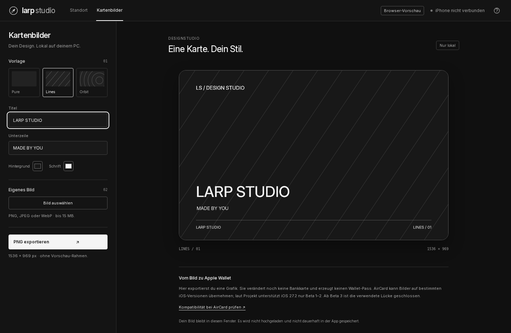

# Larp Studio

[](https://github.com/LorenzHPP/LarpStudio/actions/workflows/ci.yml)

A Windows toolkit for location simulation, smart routes, and custom card
artwork. Built with a clean monochrome interface, with more LARP features
on the way.



[German guide / Deutsche Anleitung](README.de.md) · [Roadmap](ROADMAP.md) ·
[Testing notes](PRUEFUNG.md)

## Features

- Interactive world map with place search, coordinates, draggable pins,
  and light/dark monochrome map styles.
- Fixed locations, walking, jogging, and driving routes for your own iPhone.
- Driving speeds and estimated times based on road-section data, with
  acceleration, braking, and corner handling. No live traffic feed.
- Edit or remove individual route points; pause, resume, and repeat routes.
- Local favorites and a route library with save, load, and delete.
- Card artwork studio: three templates, custom images, text, colors,
  crop positioning, zoom, and **1536 × 969 PNG** export.
- Experimental Wi-Fi connection after an initial USB setup. The PC must
  remain running and the iPhone must stay on the same reachable network.

The public version starts at **Brandenburg Gate, Berlin**. Personal places,
device selections, and pairing files are kept out of the repository.

## Run on Windows

1. Download the source ZIP and extract the entire folder.
2. Install Python 3.13, Microsoft Edge WebView2 Runtime, and working Apple
   USB drivers if they are not already installed.
3. Double-click **Start-Larp Studio.cmd**. The first launch installs pinned
   dependencies in a local `.venv` and opens the desktop window.
4. For device control, connect and unlock your iPhone, trust your PC, enable
   Developer Mode, and select **Verbinden** in the app.

The interface is currently in German. A card artwork PNG is an image export;
it does not change an Apple Pay card or create a signed Wallet pass. See the
[Wallet notes](README.de.md#was-der-wallet-bereich-kann) for compatibility.

The device interface requires iOS 17.4 or later. This is a technical minimum,
not a guarantee of support for every version. Real-device operation on
iOS 27.2, long sessions, Wi-Fi, and resetting still need hardware testing.
Check the result in Apple Maps. If resetting leaves a simulated location,
reconnect and retry; restart the iPhone if necessary.

## Build a Windows EXE

**Actions → Windows app → Run workflow** builds
the desktop application on Windows. Download the **Larp-Studio-Windows**
artifact from a successful run, extract it completely, and start
**Larp Studio.exe**. Keep all files together. Python is bundled; Apple drivers
and WebView2 are still required. Artifacts expire after 30 days.

For a local build, first run the source app once, then open
**EXE-erstellen.cmd**. The output is `dist/Larp Studio/Larp Studio.exe`.
No prebuilt EXE has been verified for this version yet.

## Development

```sh
python -m unittest discover -s tests -v
node --check ui/app.js
node --check ui/studio.js
node --check ui/library.js
python app.py --preview 8765
```

The browser preview at `http://127.0.0.1:8765` never controls an iPhone.
Artwork export and browser-local route storage work in the preview.
See [CONTRIBUTING.md](CONTRIBUTING.md) for browser checks and contribution notes.
GitHub CI runs offline tests on Windows and Linux.

Maps use OpenStreetMap, search uses Photon, and routing uses FOSSGIS/OSRM.
These services receive the requested map areas, searches, or route points.
The artwork editor processes images locally without uploading them.

## License

The added app code is **GPL-3.0-or-later**, matching its existing distribution
and the bundled pymobiledevice3 component. The original repository's MIT
notice is preserved in `licenses/ORIGINAL-REPOSITORY-MIT.txt`.
See [LICENSE](LICENSE) and [THIRD-PARTY.md](THIRD-PARTY.md) for dependencies.
